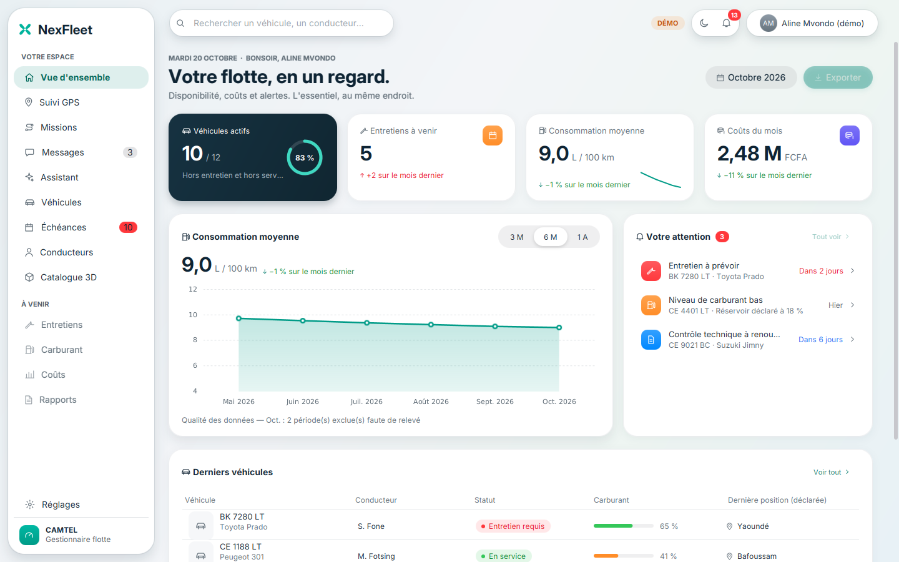
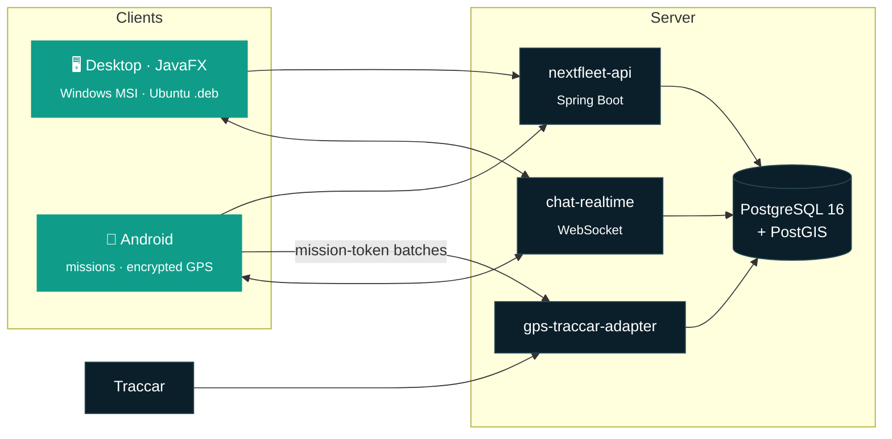

<div align="center">

# NexFleet · CAMTEL

**Fleet management for CAMTEL — vehicles, fuel, missions and live GPS, on desktop and in the field.**

[](https://github.com/rito27959-arch/Nextfleet-camtel/actions/workflows/ci.yml)


[**Build**](docs/BUILD.md) &nbsp;·&nbsp; [**Install**](docs/INSTALLATION.md) &nbsp;·&nbsp; [**Mobile**](docs/MOBILE.md) &nbsp;·&nbsp; [**Progress**](docs/ETAT_AVANCEMENT.md) &nbsp;·&nbsp; [**Design**](docs/DESIGN_ET_MOUVEMENT.md)

<br>



<sub>Desktop overview, demo data.</sub>

</div>

<br>

## Overview

NexFleet replaces CAMTEL's legacy fleet tool with a single source of truth: a Java 21 / Spring Boot API on PostgreSQL + PostGIS, a JavaFX desktop client for Windows and Linux, and a native Android app for drivers with mission GPS collection and 3D vehicle views (Filament). It implements specification **V4.0** and architecture document **V5.0**.



## What's new

| Version | Highlights |
|:--|:--|
| **0.11** | **Self-updating clients.** The server announces its version (`GET /api/v1/app/update`); Windows installs the MSI without admin rights, Ubuntu installs the `.deb`, Android downloads the APK and opens the installer. Updating the server now updates every workstation. Odometer corrections from the vehicle sheet, with reason and recalculated oil changes. |
| **0.10** | **Correct, never erase.** Vehicles, oil changes, documents, drivers and open interventions are editable; vehicles and drivers are archived and restorable for traceability. Mandatory reason, old and new value in the audit log. Fuel fills stay immutable (anti-fraud). |
| **0.9** | Directorates and sites per vehicle, a dedicated **Oil changes** screen, and **every report exportable to PDF** (A4 landscape, totals, pagination) or CSV. |
| **0.8** | **“NexFleet Pro” redesign** — a desk that opens on a *To handle* queue ranked by urgency, explained vehicle health, a 360° vehicle sheet; on Android, a mission card that follows its phase and large field tiles. |

## Six roles, six workspaces

| Role | Home workspace |
|:--|:--|
| Fleet manager | Overview, missions, messages, assistant |
| Driver | My missions — started with clear location notice |
| Maintenance | Workshop |
| Controller | Overview, trips, assistant |
| Technical administrator | Accounts and roles — no business data |
| Auditor | Hash-chained audit log, read-only |

`--demo` opens an offline demonstration of all six profiles with fictitious data and a visible **DEMO** badge.

## Rules enforced in code

> [!IMPORTANT]
> These are non-negotiable, and they live in the code — not in a policy document.

- The server is the only source of truth; clients never touch the database.
- A requester cannot approve their own fuel voucher; voucher balances are consumed atomically.
- Fuel consumption is computed full-to-full only, with inputs exposed — *“insufficient data”* rather than an invented value.
- No GPS position is accepted outside an active, authorised mission; no stale position is ever shown as *live*.
- An anomaly is a lead to investigate: no “fraud” status, no automatic sanction.
- No 3D asset is published without a reviewed licence that allows redistribution.
- Demo data is refused in production; no secret and no real data in the repository.

## Quick start

No Maven installation required:

```bash
infra/db/tests/run_db_tests.sh      # database: migrations + tests
tools/build-offline.sh              # domain, gateways, desktop: compile + tests
tools/run-integration-tests.sh      # GPS and messaging end-to-end on PostgreSQL
tools/screenshots.sh                # visual walkthrough and captures
```

## Repository layout

| Path | Contents |
|:--|:--|
| `apps/desktop-javafx/` | Desktop client — fleet, deadlines, missions, messaging, assistant, accounts, audit, 3D catalogue · DEB and EXE packages |
| `apps/android/` | Android app — missions, encrypted GPS collector, messaging, 3D catalogue (Filament) · APK |
| `services/nextfleet-domain/` | Dependency-free business core — full-to-full, vouchers, rules, GPS, access |
| `services/nextfleet-api/` | Spring Boot API — tested with Testcontainers |
| `services/gps-traccar-adapter/` | GPS gateway: Traccar JSON forward, Android mission-token batches, OsmAnd relay |
| `services/chat-realtime/` | Real-time messaging (WebSocket) |
| `shared/api-contract/` | OpenAPI 3 contracts |
| `shared/assets3d/` | Redistributable GLB models and their licences |
| `shared/ui-tokens/` | Design-system tokens |
| `infra/db/` | Flyway migrations and the database test campaign |
| `infra/deploy/camtel/` | On-premise kit: Docker Compose, HTTPS (Caddy), backups |
| `infra/docker/` | API, GPS gateway and Traccar images (published to ghcr.io) |
| `docs/` | Audit, parity register, design and motion, progress, captures |

## Status

[`docs/ETAT_AVANCEMENT.md`](docs/ETAT_AVANCEMENT.md) separates what is proven from what still needs field trials. Publishing packages is not a server deployment. **No certification or regulatory approval is claimed.** Migration from the legacy SQLite databases is described in [`docs/MIGRATION_SQLITE.md`](docs/MIGRATION_SQLITE.md).

## Third-party licences

3D models: [`shared/assets3d/LICENCES.md`](shared/assets3d/LICENCES.md) — original creations and Khronos *Toy Car* (CC0). Inter typeface (SIL OFL 1.1) bundled with the desktop client.

<br>

<div align="center">
<sub>Designed and built in Yaoundé, Cameroon.</sub>
</div>
